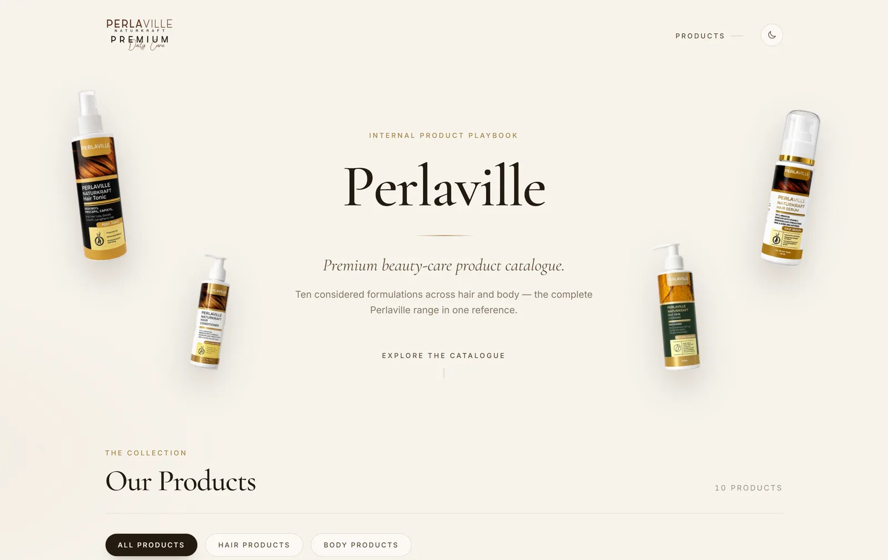
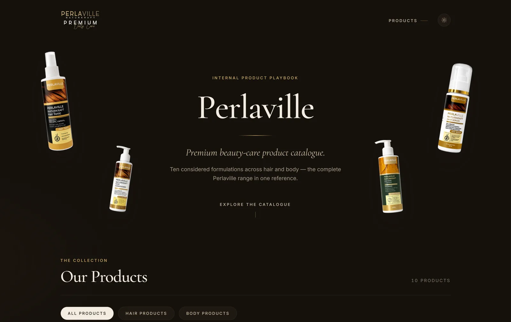
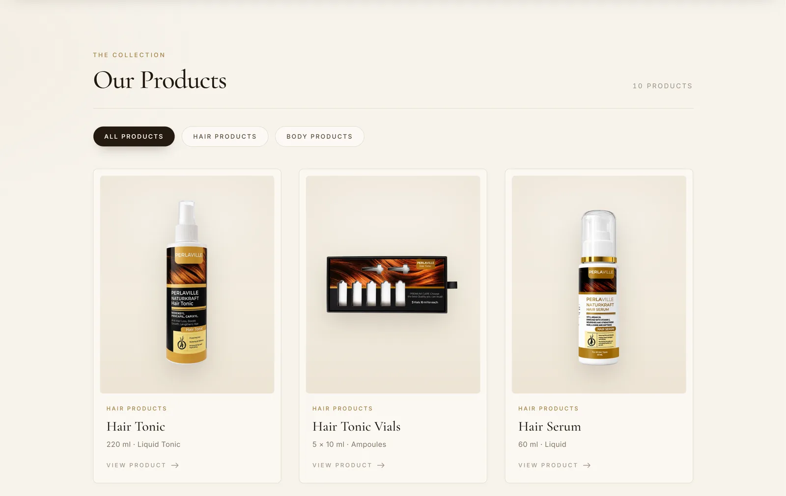
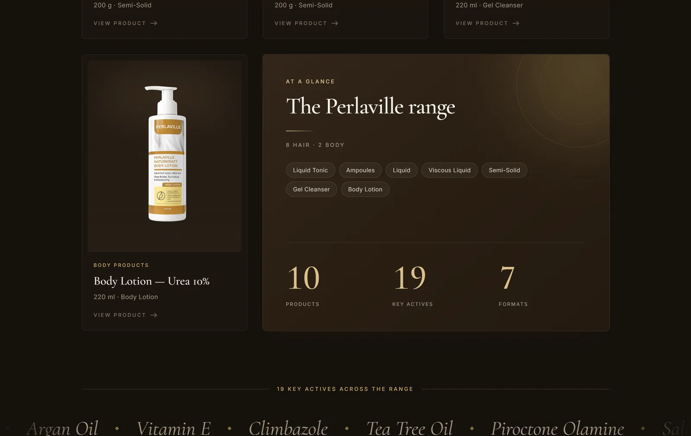
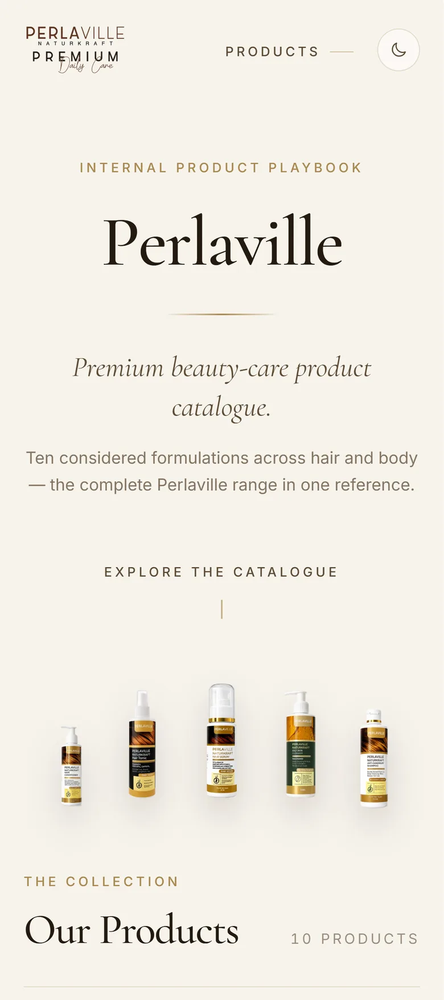

<div align="center">

# Perlaville — Product Playbook

**A product catalogue website for Perlaville, a premium hair- and body-care brand.**

[**View the live site →**](https://ammaramgad.github.io/perlaville-playbook/)




</div>

## Overview

The Perlaville Product Playbook brings the full range — ten hair and body formulations — into one
reference site for the team. Each product has its own page with size, format, key ingredients,
benefits and internal regulatory notes, and the catalogue can be filtered by category.

It is a fully static site: every page is pre-rendered at build time and served from GitHub Pages,
with no server or database.

## Highlights

- **Editorial, animated design** — floating product bottles with cursor and scroll parallax, a
  letter-by-letter title reveal, tilt-and-light card hovers, staggered reveals and a scrolling
  ingredient strip.
- **Light and dark themes** — a header toggle reveals the new theme as a circle growing from the
  button (View Transitions API). The choice is remembered and applied before first paint, so the
  page never flashes the wrong colours.
- **Fast on slow connections** — a build step turns every product photo into WebP copies at six
  widths and a custom `next/image` loader serves the right one for each screen. Entrance animations
  run in CSS, so content appears before JavaScript has loaded.
- **Responsive and accessible** — layouts from 390px phones to wide desktops, keyboard focus styles,
  ARIA labels, and every animation respects the visitor's reduced-motion setting.
- **Data-driven** — all ten products live in one typed file (`data/products.ts`); pages, filters,
  related products and the range summary are generated from it.

### Performance

Home page on a simulated slow mobile connection (1.6 Mbps, 150 ms latency, empty cache),
before and after the image pipeline and CSS-first entrances:

| | Before | After |
|---|---:|---:|
| Title visible | 26.5 s | **2.2 s** |
| Page interactive | 25.7 s | **5.1 s** |
| Data downloaded (whole page) | 14.1 MB | **1.4 MB** |

## Screenshots

<table>
  <tr>
    <td width="50%"></td>
    <td width="50%"></td>
  </tr>
  <tr>
    <td align="center"><sub>Dark mode</sub></td>
    <td align="center"><sub>Catalogue with category filters</sub></td>
  </tr>
  <tr>
    <td width="50%"></td>
    <td width="50%"></td>
  </tr>
  <tr>
    <td align="center"><sub>Product page</sub></td>
    <td align="center"><sub>Range summary panel (dark)</sub></td>
  </tr>
</table>

<p align="center">
  
  &nbsp;&nbsp;
  
</p>

## Tech stack

| Area | Choice |
|---|---|
| Framework | [Next.js 15](https://nextjs.org/) (App Router, static export) |
| UI | [React 19](https://react.dev/), [TypeScript](https://www.typescriptlang.org/) |
| Styling | [Tailwind CSS 4](https://tailwindcss.com/) with a theme-token palette for light/dark |
| Animation | [Motion](https://motion.dev/) for interactive motion, CSS keyframes for entrances |
| Images | [sharp](https://sharp.pixelplumbing.com/) build step + custom `next/image` loader |
| Fonts | Cormorant Garamond and Inter via `next/font` |
| Hosting | GitHub Pages (`gh-pages` branch) |

## Project structure

```
app/
  layout.tsx              Root layout, fonts, no-flash theme script
  page.tsx                Home: hero, catalogue, ingredient strip
  products/[slug]/        One pre-rendered page per product
  template.tsx            Page fade-in on navigation
  globals.css             Theme tokens (light + dark), keyframes, utilities
components/               Hero, header, theme toggle, product grid and cards, …
data/products.ts          The product catalogue (single source of truth)
lib/image-loader.ts       Maps images to their pre-generated WebP sizes
scripts/
  optimize-images.mjs     Generates responsive WebP copies of public/images
  publish-gh-pages.mjs    Publishes the static build to the gh-pages branch
public/images/            Original product photography and logos
```

## Running locally

Requires Node.js 20.11 or newer.

```bash
npm install
npm run dev        # http://localhost:3000
```

| Command | What it does |
|---|---|
| `npm run dev` | Generates image sizes, then starts the dev server |
| `npm run build` | Generates image sizes, then builds the static site into `out/` |
| `npm run deploy` | Builds and publishes `out/` to the `gh-pages` branch (live in about a minute) |

## Author

Designed and built by [Ammar Amgad](https://github.com/AmmarAmgad).

Product names, imagery and branding belong to Perlaville.
